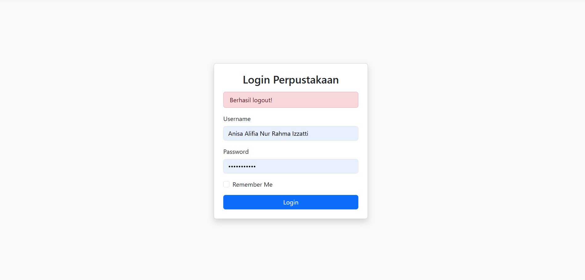
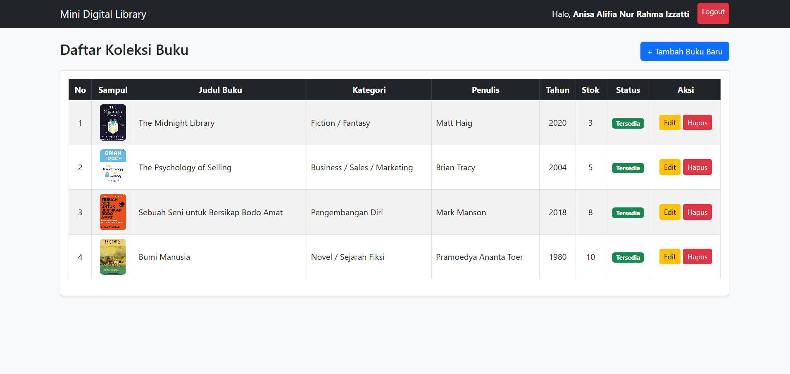
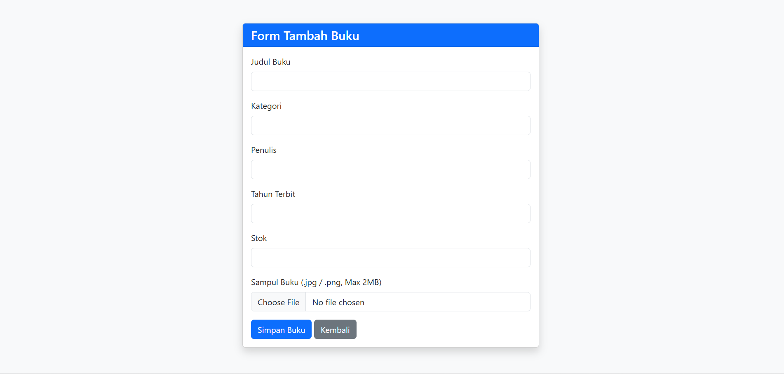
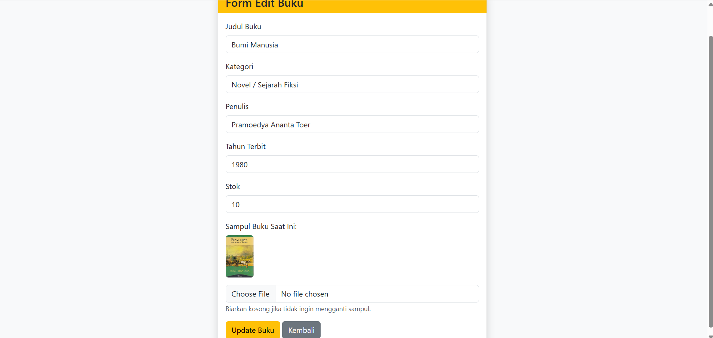

# 📚 Sistem Perpustakaan

Aplikasi web sederhana untuk mengelola data buku perpustakaan, dibuat dengan PHP dan MySQL.

## Fitur

- Login dan logout admin
- Menambah data buku (beserta upload cover)
- Mengedit data buku
- Menghapus data buku
- Dashboard untuk melihat daftar buku

## Teknologi yang Digunakan

- PHP
- MySQL
- HTML & CSS
- XAMPP (Apache + MySQL)

## Cara Instalasi

1. Clone atau download project ini, lalu letakkan di folder `htdocs`:
   ```
   C:\xampp\htdocs\project_perpustakaan
   ```
2. Jalankan **Apache** dan **MySQL** di XAMPP.
3. Buka **phpMyAdmin** (`http://localhost/phpmyadmin`).
4. Buat database baru bernama `db_perpustakaan`.
5. Import file `db_perpustakaan.sql` ke database tersebut.
6. Sesuaikan pengaturan koneksi di `config/koneksi.php` jika perlu.
7. Buka di browser:
   ```
   http://localhost/project_perpustakaan
   ```

## Struktur Folder

```
project_perpustakaan/
├── config/
│   └── koneksi.php
├── screenshots/
├── uploads/
├── dashboard.php
├── db_perpustakaan.sql
├── edit_buku.php
├── hapus_buku.php
├── index.php
├── logout.php
├── proses_edit.php
├── proses_login.php
├── proses_tambah.php
└── tambah_buku.php
```

## Screenshot

### Halaman Login


### Dashboard


### Tambah Buku

### Edit Buku


## Video Demo

Tonton video demo aplikasi di YouTube: [Klik di sini](https://youtu.be/F54UK339wCU)
## Author

Dibuat oleh **Anisa Alifia Nur Rahma Izzatti**